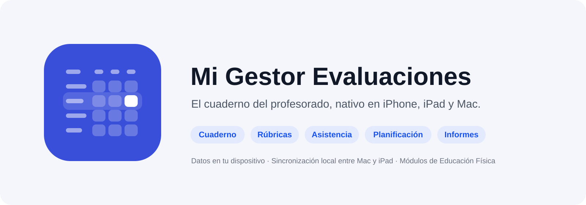
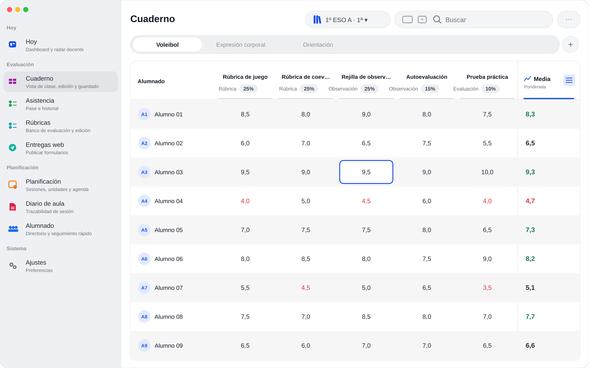
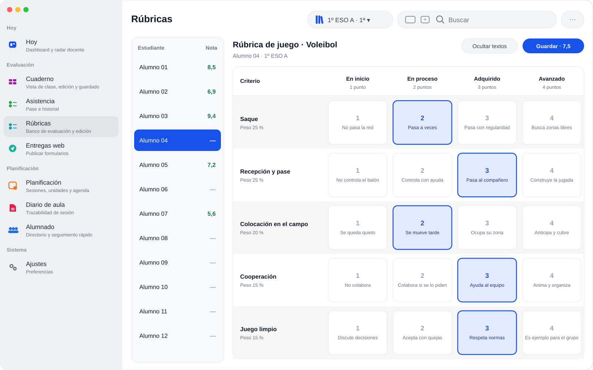
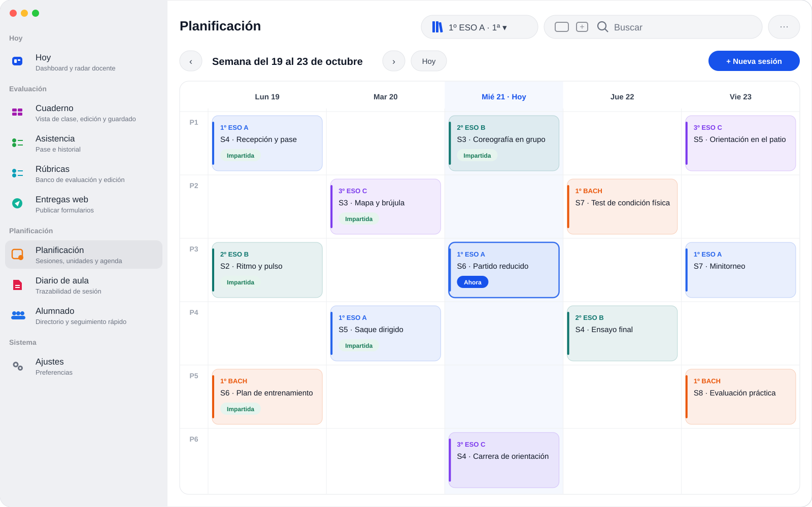
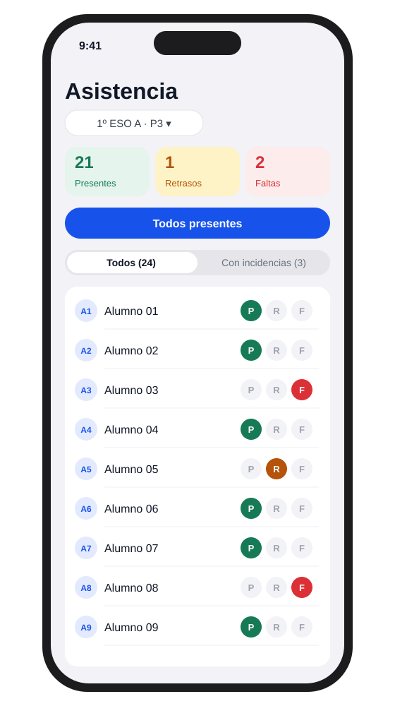

# Mi Gestor Evaluaciones

App educativa para gestion docente diaria: cuaderno, rubricas, asistencia, alumnado, planificacion, informes, sincronizacion, backups y modulos especificos de Educacion Fisica.

## Así es la app

Imágenes diseñadas con datos inventados: no son capturas de un cuaderno real.

**Cuaderno.** La tabla de notas de cada grupo, con columnas por instrumento, su tipo y su peso, y la media ponderada siempre a la vista.

**Rúbricas.** Toda la clase de una vez: un toque por criterio, el nivel se colorea de inicial a avanzado y la nota se calcula sola.

**Planificación.** La semana por franjas horarias: cada grupo con su color, lo que falta por planificar, los hitos del curso y la franja en curso resaltada.

**Asistencia en iPhone.** Pasar lista en segundos: todos presentes de una vez y solo marcar las excepciones.

## El proyecto

El proyecto empezo como app Flutter y esta evolucionando hacia una arquitectura KMP + SwiftUI:

- `kmp/shared/`: logica de negocio Kotlin Multiplatform.
- `kmp/data/`: repositorios, SQLDelight y persistencia.
- `kmp/iosApp/App/`: SwiftUI nativo iOS/iPadOS.
- `kmp/iosApp/MacApp/`: SwiftUI nativo macOS.
- `kmp/iosApp/AppleShared/`: servicios y componentes Apple compartidos.
- `kmp/desktopApp/`: Compose Desktop, target separado.
- `lib/`, `ios/`, `macos/`, `android/`, `web/`, `windows/`, `linux/`: app Flutter original y targets asociados.

## Documentacion principal

- [Indice de documentacion](docs/README.md)
- [Gobierno del repositorio](docs/REPO_GOVERNANCE.md)
- [Roadmap](docs/ROADMAP.md)
- [Changelog](docs/CHANGELOG.md)
- [Proceso de release](docs/RELEASE_PROCESS.md)
- [Licencia propietaria](LICENSE)
- [Seguridad](SECURITY.md)
- [Privacidad](PRIVACY.md)
- [Avisos de terceros](THIRD_PARTY_NOTICES.md)
- [Baseline inicial](docs/PROJECT_BASELINE_2026-06-04.md)
- [KMP README](kmp/README.md)

## Como trabajar en el repo

1. Crear una rama corta desde el estado estable mas reciente.
2. Hacer cambios pequenos y revisables.
3. Registrar el cambio en `docs/CHANGELOG.md` si afecta a producto, arquitectura, datos, build o UX.
4. Crear o actualizar un ADR en `kmp/docs/architecture/` si la decision cambia arquitectura, persistencia, integracion Apple/KMP o estrategia de plataforma.
5. Abrir PR usando la plantilla de `.github/pull_request_template.md`.

## Estado actual

La app ya esta empezada y contiene trabajo historico que no se documento de forma sistematica. Desde el 2026-06-04, la documentacion canonica se organiza en `docs/` y el historial de cambios debe pasar por PRs pequenos.

Para la fotografia inicial del estado del proyecto, ver [PROJECT_BASELINE_2026-06-04.md](docs/PROJECT_BASELINE_2026-06-04.md).
