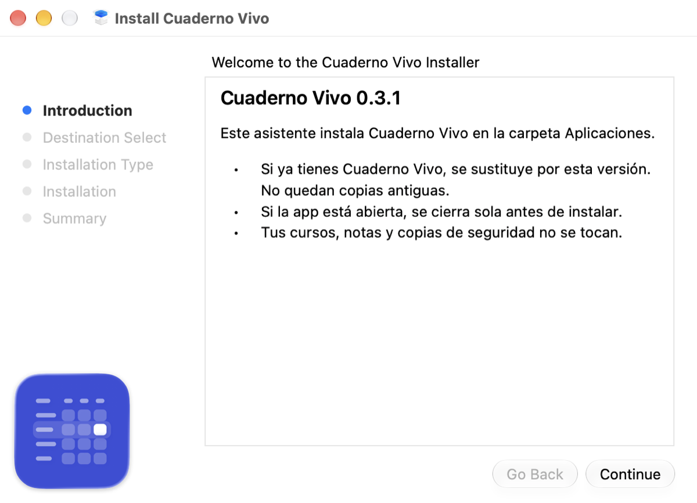

# Distribución de Cuaderno Vivo para Mac

Cómo publicar una versión nueva de la app de Mac para que cualquiera pueda descargarla.

## Dónde se publica

- El código sigue en el repositorio privado `mafepa21/mi_gestor_evaluaciones`.
- Las descargas van a un repositorio **público** aparte, [`mafepa21/cuaderno-vivo`](https://github.com/mafepa21/cuaderno-vivo), que solo contiene un README y los Releases con el `.dmg`.
- El README público y la guía de importación viven versionados aquí: [`README_descargas.md`](README_descargas.md) y [`GUIA_IMPORTACION.md`](GUIA_IMPORTACION.md), y la licencia de uso en [`LICENCIA_descargas.md`](LICENCIA_descargas.md) (en el repositorio público se llama `LICENSE`). Si cambian, se copian al repositorio público.
- Si cambia un importador (horario, alumnado, SA, sesiones, instrumentos), revisa la guía: sus reglas salen del código de `kmp/iosApp/AppleShared/*Import*.swift` y de `docs/importacion_documentos_sa.md`.

## Por qué firma ad hoc

- La cuenta de Apple Developer es gratuita: no permite firmar con «Developer ID» ni notarizar.
- La firma ad hoc (`codesign --sign -`) basta para que la app arranque en Macs con chip Apple.
- Contrapartida: macOS bloquea la primera apertura y el usuario tiene que pulsar «Abrir igualmente» en Ajustes > Privacidad y seguridad. El README público lo explica paso a paso.

## Instalador

- El `.dmg` lleva solo «Instalar Cuaderno Vivo.pkg»: el asistente de instalación de macOS, en español (`scripts/mac-installer/`).
- Antes de copiar, `preinstall` cierra la app (como ⌘Q) y el ayudante de sincronización, y borra `/Applications/Cuaderno Vivo.app` entera. Así no quedan archivos de la versión anterior ni copias como «Cuaderno Vivo 2».
- El componente no es reubicable ni comprueba versión: siempre instala en `/Applications` y siempre deja su versión, también al reinstalar la misma.
- Los datos (`~/Library/Application Support/MiGestor`) y las copias de seguridad no se tocan.
- El `.pkg` tampoco está firmado: la primera vez macOS lo bloquea y hay que pulsar «Abrir igualmente» igual que con la app.
- Pasos del asistente: Introducción (con el icono de la app) → Instalar → contraseña → Resumen. El paso de destino se salta solo.


- Funciona porque el target de Mac no usa permisos restringidos (iCloud, App Groups...). Si algún día se añade uno, la firma ad hoc dejará de servir y hará falta la cuenta de pago.

## Pasos para publicar una versión

1. Sube `MARKETING_VERSION` del target `MiGestorKMPMac` en `kmp/iosApp/project.yml` y regenera con `xcodegen generate`.
2. Desde la raíz del repositorio, en una rama ya fusionada:

   ```bash
   scripts/package_mac_release.sh
   ```

   Deja en `build/release-mac/` el archivo `CuadernoVivo-<versión>.dmg` y su `.sha256`.
3. Prueba el `.dmg` en un Mac: ábrelo, abre «Instalar Cuaderno Vivo.pkg», sigue el asistente y comprueba que en Aplicaciones queda una sola «Cuaderno Vivo» con la versión nueva.
4. Publica el Release en el repositorio público:

   ```bash
   gh release create v<versión> build/release-mac/CuadernoVivo-<versión>.dmg build/release-mac/CuadernoVivo-<versión>.dmg.sha256 --repo mafepa21/cuaderno-vivo --title "Cuaderno Vivo <versión>" --notes "Novedades de esta versión..."
   ```

## Límites conocidos

- Solo Apple Silicon: `MiGestorKit.framework` se compila solo para arm64.
- Requiere macOS 26 o posterior (`deploymentTarget` del proyecto).
- Sin actualizaciones automáticas: el usuario descarga el `.dmg` nuevo a mano.
- Los datos no dependen del nombre de la app: se guardan en `~/Library/Application Support/MiGestor` y el identificador sigue siendo `com.migestor.mac`.
